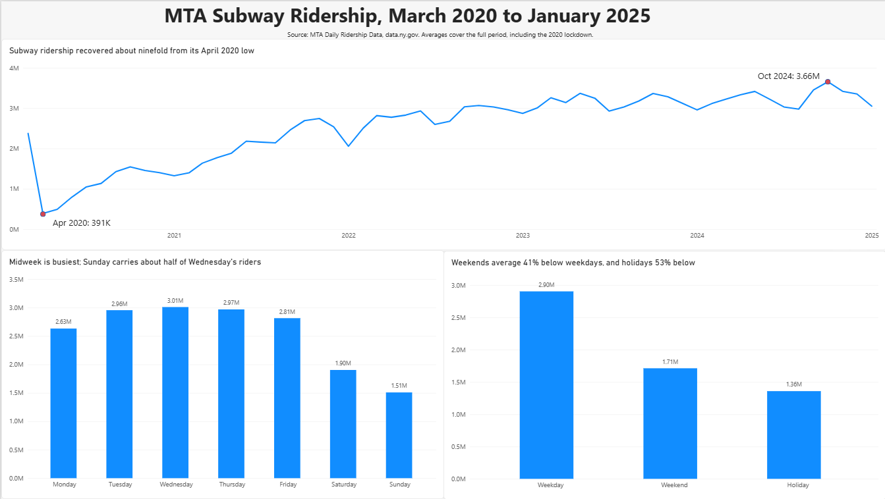

# MTA Daily Ridership: Data Quality and Analysis

A SQL project that checks the quality of the MTA's public daily ridership data and analyzes how New York City subway ridership recovered from March 2020 to January 2025.

**Tools:** MySQL 9, MySQL Workbench, Power BI

## Questions

1. Can this data be trusted? Are there duplicate, missing, or suspicious records?
2. Which days of the week are busiest?
3. How much lower is ridership on weekends and major holidays than on weekdays?
4. How did subway ridership change month by month after the pandemic began?

## Key findings

- **Subway ridership grew about ninefold** from its lowest month, April 2020 (about 391,000 riders a day), to its highest, October 2024 (about 3.66 million a day). The recovery was steady, with recurring dips each winter (December to January) and in summer.
- **Midweek is busiest.** Wednesday averaged about 3.01 million riders and Sunday about 1.51 million, roughly half. Ridership peaks Tuesday through Thursday, with Monday and Friday noticeably lower, a pattern consistent with hybrid work schedules.
- **Weekends average about 41% below weekdays**, and **major holidays about 53% below**, lower even than a typical weekend.
- **The data is complete:** every day from 2020-03-01 to 2025-01-09 appears exactly once, with no missing values. One anomaly was found and flagged: 32 days of zero Staten Island Railway ridership, all on weekends.

All averages cover the full period, 2020-03-01 to 2025-01-09, including the 2020 lockdown.

## Data

**Source:** [MTA Daily Ridership Data](https://data.ny.gov), NY Open Data portal. A copy of the original file is included in `data/`.

1,776 rows, one per day from 2020-03-01 to 2025-01-09. For each of seven services (subway, bus, LIRR, Metro-North, Access-A-Ride, Bridges and Tunnels, Staten Island Railway) there are two columns:

- **Total ridership** (or trips or traffic) for that day
- **% of comparable pre-pandemic day:** that day's ridership as a share of a similar pre-pandemic day of the same type. For example, a Saturday is compared with a pre-pandemic Saturday, and 60% means the service carried 60% of its pre-pandemic volume.

This analysis focuses on subway ridership. The other services were cleaned and quality-checked.

## Method

### 1. Import

The raw CSV stores every value as quoted text: dates as `MM/DD/YYYY`, counts with thousands commas (`"2,212,965"`), and percentages with a `%` sign (`"97%"`). Spreadsheet apps hide this formatting, so the raw file was inspected in a plain text editor first.

The file was imported into MySQL as `ridership_raw` with every column set to `TEXT`, keeping the original values intact. A row count confirmed all 1,776 rows loaded.

### 2. Clean

The 15 columns were renamed to short snake_case names (for example, `subway_ridership`, `subway_pct`, with `sir_` for Staten Island Railway). A clean table, `ridership_clean`, was then built with `CREATE TABLE ... AS SELECT`:

- `STR_TO_DATE` converted text dates to real dates.
- `REPLACE` and `CAST(... AS UNSIGNED)` stripped commas and `%` signs and converted values to whole numbers.

Before converting, a check confirmed that no percentage value in the raw data contained a decimal, so converting to whole numbers lost no information.

### 3. Quality checks

| Check | Method | Result |
|---|---|---|
| Row count | `COUNT(*)` | 1,776, matches the file |
| Duplicate dates | `GROUP BY` with `HAVING COUNT(*) > 1` | None |
| Missing dates | `COUNT(DISTINCT ride_date)` vs. `DATEDIFF(MAX, MIN) + 1` | Both 1,776, so no gaps and no NULL dates |
| Missing values | `SUM(column IS NULL)` for all 7 services | None |
| Zero values | `SUM(column = 0)` for all 7 services | 32 Staten Island Railway days |
| Decimal loss | `LIKE '%.%'` on raw percent columns | None |

### 4. Investigate and flag anomalies

**Staten Island Railway zero days.** All 32 days with zero ridership fall on weekends, 16 Saturdays and 16 Sundays, between 2020-06-21 and 2021-08-15, in consecutive Saturday-Sunday pairs. A scheduled pattern like this points away from random missing data. The likely explanation is no service, or no counting, on those weekends, but the cause is not confirmed in the dataset.

These rows were **kept and flagged**, not deleted. Deleting them would break the complete-date check. A `sir_flag` column marks them (`no_service` for the 32 days, `ok` for the rest) so they can be excluded from Staten Island averages.

**Days with riders but 0%.** Some days show Staten Island ridership above zero but 0% of pre-pandemic levels (for example, 2020-05-30: 18 riders, 0%). The raw file stores percentages as whole numbers, so any share under 0.5% rounds to 0%. This is a rounding effect in the source data, not an error.

### 5. Analysis

A `holidays` lookup table was created with 30 major holidays (New Year's Day, Memorial Day, Independence Day, Labor Day, Thanksgiving, Christmas) from May 2020 through January 2025. Each day was then labeled with a `LEFT JOIN` and `CASE`:

- `holiday` if it matched the holidays table, checked first so holidays falling on weekends count as holidays
- `weekend` if Saturday or Sunday
- `weekday` otherwise

| Day type | Days | Avg. subway riders | vs. weekdays |
|---|---|---|---|
| Weekday | 1,245 | 2,903,976 | baseline |
| Weekend | 501 | 1,712,740 | about 41% lower |
| Holiday | 30 | 1,358,594 | about 53% lower |

| Day | Avg. subway riders |
|---|---|
| Sunday | 1,508,318 |
| Monday | 2,631,651 |
| Tuesday | 2,955,051 |
| Wednesday | 3,009,866 |
| Thursday | 2,968,433 |
| Friday | 2,814,682 |
| Saturday | 1,903,372 |

**Extremes:** the busiest single day was 2020-03-04 (5,498,809 riders), one week before pandemic shutdowns. The quietest was 2020-04-12 (198,399 riders), Easter Sunday during the lockdown.

## Limitations and assumptions

- **Holiday sample is small.** Only 30 holidays, and 5 fall in 2020 when ridership was lowest overall, so the holiday average likely leans low. The direction of the finding is solid; the exact percentage is approximate.
- **Holiday dates are actual, not observed.** When a holiday fell on a weekend (for example, July 4, 2020), the actual date was used rather than the weekday it was observed. Columbus Day / Indigenous Peoples Day was not included, to keep the comparison to major closure holidays.
- **Staten Island zero weekends** are treated as no-service days, but the cause is not confirmed.
- **Bus ridership looks unusually low in spring 2020** (for example, 2020-05-30: 9,112 riders, 1% of normal, while the subway was at 13%). This was not investigated, and bus figures from that period should be treated with caution.
- **January 2025 is a partial month** (9 days), so its monthly average is not comparable to full months.
- **Explanations for patterns are hypotheses.** The midweek peak is consistent with hybrid work, and the seasonal dips with holidays, weather, and vacations, but this dataset alone cannot confirm the causes.

## Dashboard

A Power BI dashboard built from `ridership_clean.csv` summarizes the three main findings:

- **Monthly trend:** average daily subway ridership by month, March 2020 to January 2025, showing the recovery and the recurring winter and summer dips
- **Day of week:** average subway ridership for each day, Sunday through Saturday
- **Day type:** weekday vs. weekend vs. holiday averages

## Repository contents

| File | Description |
|---|---|
| `mta_ridership.sql` | Full SQL script: import notes, cleaning, quality checks, flagging, and analysis, with results commented under each query |
| `data/MTA_Daily_Ridership_Data__2020_-_2025_20261009.csv` | Original MTA Daily Ridership Data, as downloaded from data.ny.gov |
| `data/ridership_clean.csv` | Cleaned table exported from MySQL |
| `dashboard/[DASHBOARD FILE NAME].pbix` | Power BI dashboard file |
| `images/dashboard.png` | Dashboard screenshot shown above |
| `README.md` | This file |

## How to reproduce

1. Clone or download this repository. The raw data is included at `data/MTA_Daily_Ridership_Data__2020_-_2025_20261009.csv`.
2. In MySQL Workbench, run the first two statements of `mta_ridership.sql` to create the database.
3. Import `data/MTA_Daily_Ridership_Data__2020_-_2025_20261009.csv` with the Table Data Import Wizard as `ridership_raw`, with every column set to `TEXT`.
4. Run the rest of the script from top to bottom.
5. To view the dashboard, open `dashboard/[DASHBOARD FILE NAME].pbix` in Power BI Desktop.
